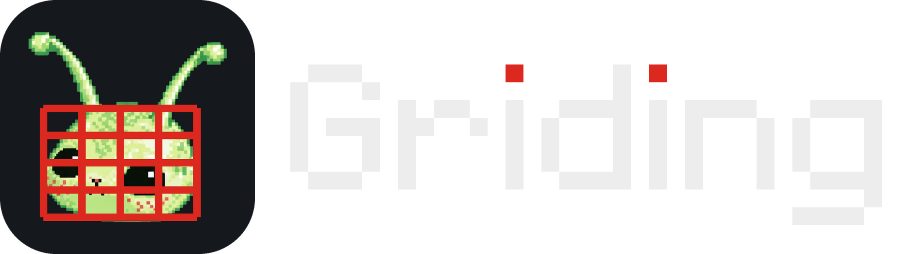

# Griding

A Windows app that covers the faces in live-action plates with a grid or a solid mask, so the footage can go into Seedance.
It starts from a single `Griding.bat` with no ComfyUI, and everything runs on your own PC.



## Using it

Download the zip from [Releases](../../releases), extract it, and double-click `Griding.bat`. If it freezes because of the graphics card, start `Griding_CPU.bat` instead.
On first launch it puts a Griding shortcut with the app icon on your desktop. The step-by-step guide is in [사용법.txt](사용법.txt) (Korean).

What it does:

- Finds every person in the clip and numbers them, so you can pick who to cover.
- Stacks cards in any order: grid, face-outline cover, whole-head cover, face lines, face points, tracking boxes.
- Each mask has its own color palette and opacity.
- Saves an H.264 mp4 at a constant bitrate (30 Mbps up to 2K, 50 Mbps for 4K, or the source bitrate), keeping the source resolution, fps, color space and audio.
- Can also export one lossless transparent MOV per card for compositing in AE or Premiere.
- Re-running a plate either stacks a new version (`_v2`, `_v3`) or overwrites the same folder.

## Working on it

This repo does not include the Python runtime and libraries (`app/python`, `app/lib`, about 460 MB); they are too big for Git.
Copy those two folders once from the release zip into the same place in your clone, and it runs.

```
git clone https://github.com/ppqwpe/griding.git Griding
(copy Griding\app\python and Griding\app\lib from the release zip into Griding\app\)
Griding\Griding.bat
```

Run the tests after any change. All 155 should pass.

```
app\python\python.exe app\tests\run_tests.py
```

Build a new release zip like this. It lands next to the repo folder as `Griding_배포.zip`.

```
app\python\python.exe app\tools\build_zip.py
```

### Layout

| Path | What's there |
|---|---|
| `app/facegrid/` | The app itself (the Python package keeps the old name `facegrid`) |
| `app/ui.html` | The whole browser UI in one file (HTML, CSS, JS) |
| `app/tests/` | Automated tests |
| `app/model/` | Two head-detection models, the face landmark model, the sample character images |
| `app/tools/` | Scripts for the logo, the sample character's face points, and the release zip |
| `로고/` | Logo PNGs: icon at several sizes, and horizontal versions with the pixel wordmark |

To change the logo, edit `app/tools/make_logo.py` and run it. For the sample character's face points, edit `app/tools/make_character_face.py`.

### Workflow

Keep `main` releasable at all times. Make changes on a separate branch, and merge into `main` once the tests pass.
To ship, build the zip with `build_zip.py` and attach it to a new GitHub Release with a version number (v1.1 and so on). People then just download it from that page.

## Models and licenses

| Step | Model | License |
|---|---|---|
| Head detection | YOLO11s / YOLO11m head (deepghs/real_head_detection, ONNX) | Not stated by the authors; trained with Ultralytics (AGPL-3.0), so treat as AGPL-3.0 |
| Face landmarks | Google MediaPipe Face Landmarker (478 points) | Apache-2.0 |
| Read / write video | FFmpeg 7.1 (gyan.dev essentials build, bundled with imageio-ffmpeg 0.6.0) | GPL-3.0 |

Every bundled library and its license is listed in [THIRD_PARTY_NOTICES.md](THIRD_PARTY_NOTICES.md).
